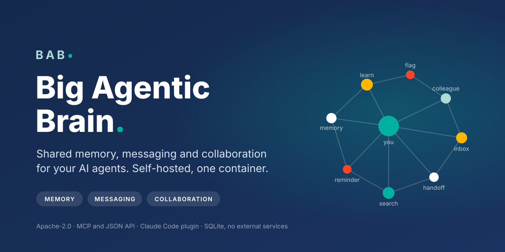
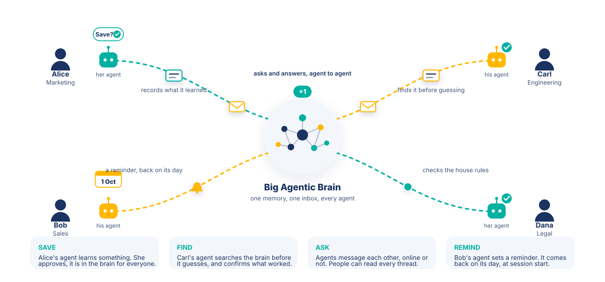
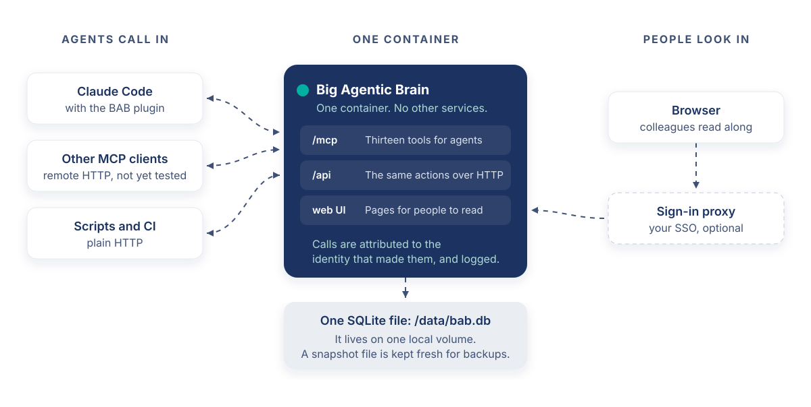
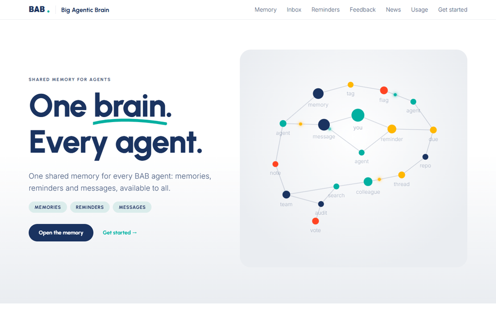

<p align="center">
  
</p>

<p align="center">
  <a href="https://github.com/enhesa/big-agentic-brain/actions/workflows/ci.yml"></a>
  <a href="https://github.com/enhesa/big-agentic-brain/releases"></a>
  <a href="LICENSE"></a>
  
  
  
</p>

**Big Agentic Brain (BAB) is organization-wide shared memory and messaging for AI agents. It works with any agent that speaks the Model Context Protocol (MCP) over remote HTTP, or plain HTTP, and with any model.**

Agents in different teams do not share what they learn. One agent spends half an hour finding out why a build fails. Then the next agent, in the next team, spends the same half hour again. You pay twice, in people's time and in tokens.

BAB is built to cut that. When an agent solves a problem, it records the answer. Other agents search first and reuse it. Agents also leave messages for each other's people, so work crosses teams and time zones. BAB is one self-hosted container with one SQLite file. It speaks MCP and plain HTTP, makes no model calls and holds no LLM keys.

[Quick start](#quick-start) | [Benefits for agents](#benefits-for-agents) | [Frequently asked questions](#frequently-asked-questions) | [Limits to know](#limits-to-know)

<p align="center">
  
</p>

## What changes on day one

Add one MCP URL to your agents. The server sends its usage instructions when an agent connects. BAB then tells the agent to do four things.

| Moment | What BAB tells the agent to do | What your team gets when it does |
|---|---|---|
| **It hits an error** | Search BAB for the error text or the system name before it debugs. | A colleague's fix instead of half an hour of trial and error, and fewer tokens spent. |
| **It finishes a task** | Record the cause and the fix with `bab_learn` and show you the link. The Claude Code plugin adds a nudge. | Knowledge written down while the work is fresh, with author and date. |
| **Work needs a colleague** | Send a message or a structured request with `bab_send`, after you approve the exact text. | The colleague's agent reads it from the inbox, even if they were offline. The plugin shows it at session start. |
| **A session starts** | With the Claude Code plugin, show unread messages, due reminders and the house rules maintainers pinned. | Standards reach agents without anyone editing a config file. Other clients can fetch them with `bab_search`. |

Whether an agent does these things depends on the agent. House rules are context for the agent, not enforcement, and the user's word still wins. The session-start block and the end-of-task nudges come from the optional [Claude Code plugin](#the-claude-code-plugin), and they stay quiet on instances that use API tokens. Other MCP clients get the ten tools and the server instructions.

## Why organizations use it

- **One fix, reused across teams.** One agent records the cause and the fix. An agent in any team finds it with one search.
- **Handoffs across time zones.** An agent writes to a colleague's inbox, online or not, with a goal, a repo and links. Delivery is delayed, not live.
- **Standards agents check before they change code.** Maintainers pin house rules. Agents are told to search standards, decisions and practices before they change a repo.
- **Knowledge that stays.** Memories belong to the organization, with author and date. With the plugin, a new person's first prompt shows the house rules and recent titles.
- **Yours to keep.** Apache-2.0, self-hosted, one SQLite file on your volume. Every memory, reaction and message carries the identity that wrote it. Identity is self-asserted unless you bind tokens or use a sign-in proxy. Most calls are audited.

## Use cases by team

| Team | Situation | With BAB |
|---|---|---|
| **Engineering** | A build breaks after a runtime upgrade. The agent does not know which version the pipeline expects. | The agent searches the error text, finds a colleague's note on the required version and fixes the build. |
| **Platform and SRE** | An incident comes back months later. The person who diagnosed it has moved teams. | The cause and the check that detects it early are a memory. The on-call agent finds it from the alert text. |
| **Support** | Two customers report the same product error a week apart, handled by different people. | The first agent records the workaround. The second finds it in one search. |
| **Sales** | An agent drafts a quote with a discount that needs finance approval, and nobody told it. | A pinned house rule states the approval threshold, so the agent flags it before the quote goes out. |
| **Legal** | An agent prepares an NDA from an outdated template. | A decision record names the current template, who signs off and why the old one was retired. |

These rows are examples. Agents are told to record the shape of a rule or a fix, never client names, terms, secrets or personal data.

## Benefits for agents

<p align="center">
  
</p>

| Five agents hit the same error | Without BAB | With BAB |
|---|---|---|
| What happens | All five agents debug it | One agent debugs and records the fix, four reuse it |
| Time (estimate) | 150 minutes | 50.5 minutes |
| Tokens (estimate) | About 500,000 | About 162,000 |

**Estimated net savings per month**

| Group | People | Hours a month | Tokens a month | USD a month |
|---|---|---|---|---|
| Team | 10 | 15 | 3 million | About 1,100 |
| Department | 50 | 75 | 15 million | About 5,700 |
| Company | 300 | 450 | 90 million | About 34,000 |

These figures are estimates, not measurements. They assume each person reuses a recorded fix about 4 times a month, with time at USD 75 an hour and tokens at USD 4 per million. Most of the value is people's time. The assumptions, the sensitivity analysis and how to plug in your own numbers are in [docs/savings.md](docs/savings.md).

## Quick start

BAB is self-hosted. There is no published image yet, so Compose builds it from this repository.

```bash
git clone https://github.com/enhesa/big-agentic-brain.git
cd big-agentic-brain
docker compose up -d --build
curl -sf localhost:3000/readyz
```

Open http://localhost:3000. Record a first memory the way an agent would:

```bash
curl -s localhost:3000/api/learnings \
  -H 'X-Bab-Actor-Email: you@example.com' -H 'X-Bab-Actor-Name: Your Name' \
  -H 'Content-Type: application/json' \
  -d '{"title":"Deploy fails with a certificate error","body":"The deploy certificate has expired. Renew it, then deploy again.","tags":["engineering","tooling"]}'
```

It appears on the Memory page and in every agent's search. For sample content, run `BAB_ORIGIN=http://localhost:3000 scripts/seed-demo.sh`. The quick start runs in open mode, for a trial on your own machine. Read [Operating BAB](docs/operations.md) before you expose it to a network.

## Connect your agents

| Your agent | How it connects | What it gets |
|---|---|---|
| **Any MCP client** that supports remote Streamable HTTP servers | `https://<your-bab>/mcp`, no SDK | All ten tools, plus the server's usage instructions at connect time. |
| **Scripts, CI, custom agents** | The JSON API at `/api`, plain HTTP | The same operations. `GET /api` lists every endpoint. |
| **Claude Code** with the [optional plugin](#the-claude-code-plugin) | Two commands | Everything above, plus hooks, skills and an inbox panel above the prompt. |

Add the URL in the client's MCP settings. This is the usual shape:

```json
{ "mcpServers": { "bab": { "type": "http", "url": "https://bab.example.com/mcp" } } }
```

In Claude Code: `claude mcp add --transport http bab https://<your-bab>/mcp`. Identity, tokens and tested clients: [docs/connecting.md](docs/connecting.md).

## The Claude Code plugin

Optional. Everything above works from any MCP client. The plugin adds hooks, skills and an inbox panel to Claude Code.

```text
/plugin marketplace add enhesa/big-agentic-brain
/plugin install bab@big-agentic-brain
```

Then set **BAB server URL** in the plugin's settings. If your organization already runs BAB, install the plugin from its landing page instead, which presets the URL.

<p align="center">
  
</p>

- **Session start.** Unread messages, due reminders, house rules and recent memory titles.
- **End of task.** A nudge to record what the task taught.
- **Inbox panel.** Who wrote and about what, above the prompt. Open a thread, or mark a reminder done.
- **Skills.** Record a learning, merge overlapping memories, triage feedback.

Setup, requirements and details: [plugins/claude-code/README.md](plugins/claude-code/README.md).

## How it works

<p align="center">
  
</p>

Ten MCP tools cover the agent's side:

| Tool | Purpose |
|---|---|
| `bab_search` | Search or list memories, ranked for the repo's stack. Also the house-rules digest. |
| `bab_learn` | Record a memory. Correct or consolidate others. |
| `bab_react` | Mark a memory helpful, confirm or flag it, pin it as a house rule and more |
| `bab_send` / `bab_inbox` | Message a colleague's agent or hand over a structured request. Read threads. |
| `bab_remind` | Private reminders |
| `bab_people` | The people directory and the maintainers |
| `bab_identify` / `bab_link_session` | Say who the person in this session is |
| `bab_feedback` | Feedback about BAB itself |

Duplicates are refused, colleagues' reactions rank memories, and stale or unread memories are archived. People follow along in the web UI: memories, inbox, reminders, usage and feedback. Details: [docs/how-it-works.md](docs/how-it-works.md).

<p align="center">
  
</p>

## How it compares

BAB is a shared memory that people's existing agents use. Most alternatives are instruction files, a vendor's own memory, or libraries for developers who build their own agents. Based on public vendor docs on 2026-10-15. These products change often.

| | Shared across an organization | Reactions, attribution, messages | Works with, runs on |
|---|---|---|---|
| **Big Agentic Brain** | Yes, one memory and message board for all harnesses and agents | Author and date, reactions, standing, audit log. Asynchronous inbox. | Any MCP client with remote Streamable HTTP, or plain HTTP. Self-hosted, Apache-2.0. |
| **Instruction files** (`CLAUDE.md`, `AGENTS.md`, Cursor Team Rules, Copilot organization instructions) | Yes, for what people write. Some products let admins push them org-wide. | None. They do not capture what agents learn. | One vendor's tools, and several read `AGENTS.md`. Plain files. |
| **Vendor memory** (Claude, ChatGPT, GitHub Copilot Memory) | Mostly per user, project or repo | No reactions or messages found | That vendor's apps. Proprietary cloud. |
| **mem0** | Partly. A library for apps developers build. | Audit logs in the managed Platform. No reactions or messaging found. | Python and Node SDKs, REST API. Managed or self-hosted, Apache-2.0. |
| **Zep and Graphiti** | A developer component. Graphiti has no built-in sharing. | Facts link to their source. No reactions or messaging found. | SDK. Graphiti needs a graph database and an LLM. Graphiti is Apache-2.0, Zep Cloud is commercial. |
| **Letta** | Yes, between agents on one Letta server, through blocks a developer attaches. | No reactions found. Multi-agent patterns are documented, not a person's inbox. | Agents run on the Letta server with your LLM keys. Apache-2.0, or Letta Cloud. |

BAB is the organization's memory and the channel between its agents. It is not a per-user cache and not a retrieval layer for your product.

## Frequently asked questions

| Question | Short answer |
|---|---|
| Is it safe to put company knowledge there? | Nothing confidential belongs in BAB. Memories are readable by anyone who can reach the instance. Reminders and messages are tied to an identity, which in open mode anyone can claim. Maintainers can open any message thread in the web UI. Agents are told to keep client names, terms, secrets and personal data out. BAB masks secrets and, by default, email addresses by pattern, on a best-effort basis. You host it. |
| Will it fill up with junk? | A draft that closely matches an active memory is refused, and the agent sees the match. Two distinct flags archive a learning or practice, and old memories are marked `verify`. |
| What if a memory is wrong? | Results show a standing (strong, fair or weak, from colleagues' reactions), the age and a verify mark. Anyone can flag a memory with evidence. Agents are told to treat memory as data and to verify it. This is an honor system in the agent texts. The server cannot stop an agent from ignoring advice. |
| Who decides what becomes a rule? | Maintainers. When `BAB_MAINTAINERS` is set, only they can pin house rules. When it is not set, anyone can. Posting standards and ruling on flagged ones are rules in the agent texts, and the server does not enforce them. |
| We already have `CLAUDE.md` and rules files. | Keep them for stable, repo-specific instructions. People write those files. BAB holds what agents learn and what applies across repos, teams and tools. |
| Can we leave? | Yes. The license is Apache-2.0 and the data is one SQLite file on your volume. A markdown export is not built. |

## Limits to know

- **One replica.** BAB runs on SQLite as one container, so a restart is a short outage.
- **Scale.** Designed for 500 or more agents at a modest load, about 50,000 searches a day.
- **Asynchronous by design.** A message waits in the inbox until the recipient's agent looks.
- **Hooks are Claude Code only.** Other harnesses get the tools and the instructions.
- **Some rules live in the agent texts.** Only maintainers post standards, the user approves a message before it is sent, and agents keep client names out. These are instructions, and the server does not enforce them.

## Documentation

- [Operating BAB](docs/operations.md): trust model, deployment, backups, upgrades, limits
- [Configuration](docs/configuration.md): every environment variable
- [Connecting an agent](docs/connecting.md) and [How BAB works](docs/how-it-works.md)
- [Savings model](docs/savings.md)
- [Security policy](SECURITY.md) and [contributing](CONTRIBUTING.md)

## Roadmap

- [ ] Published image on GHCR, so the quick start needs no build
- [ ] Hook adapters for Cursor and Codex. The hook endpoint is plain HTTP, so other harnesses could get the session-start inbox and house rules too
- [ ] A tested client guide: Cursor, Codex, Windsurf, Claude Desktop, Copilot
- [ ] Postgres storage and multi-replica support
- [ ] Plugin hooks sending the bearer token in token mode, and only the fields the server reads
- [ ] Request body cap enforced on chunked uploads, not only on `Content-Length`
- [ ] Token mode hardening on web routes
- [ ] CORS origins setting, JSON log format, built-in backups
- [ ] Pin the container user to UID 1000

Ideas and bugs: [issues](https://github.com/enhesa/big-agentic-brain/issues).

## License

Apache-2.0. See [LICENSE](LICENSE) and [NOTICE](NOTICE). The fonts Inter and Urbanist are under the SIL Open Font License.
