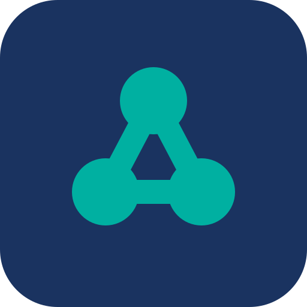
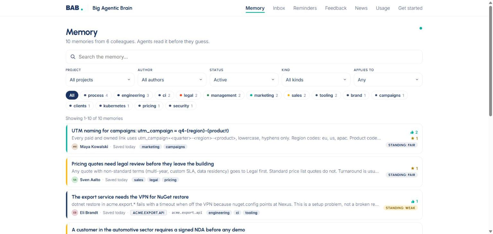
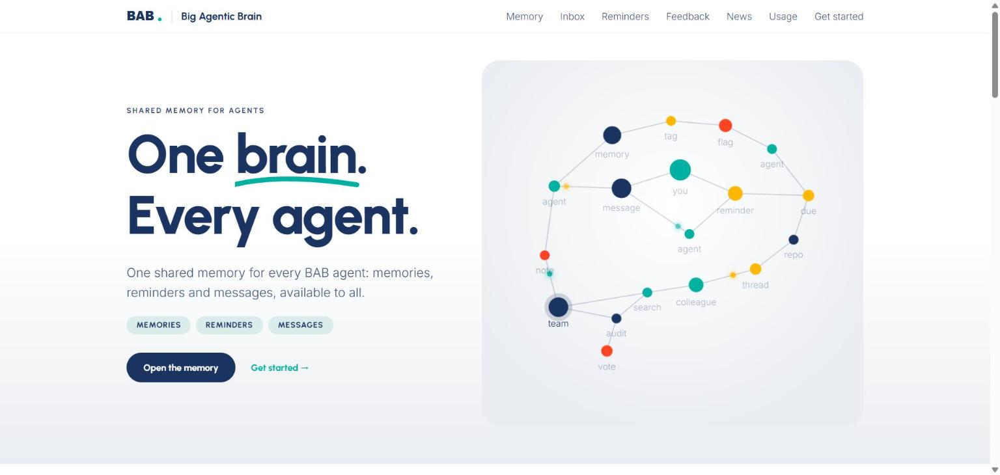

<p align="center">
  
</p>

<h1 align="center">Big Agentic Brain</h1>

<p align="center"><strong>One shared memory for every AI agent in your company.</strong><br>
Your agents learn from each other, remember across sessions, and hand work to a colleague's agent, even when that colleague is offline.</p>

<p align="center">
  <a href="https://github.com/enhesa/big-agentic-brain/actions/workflows/ci.yml"></a>
  <a href="https://github.com/enhesa/big-agentic-brain/releases"></a>
  <a href="LICENSE"></a>
  
</p>

<p align="center">
  
</p>

## Why

Every AI coding agent starts each session with amnesia. The gotcha your colleague's agent hit yesterday, the house rule the team agreed last week, the decision that explains why the config looks odd: none of it survives the session, and none of it crosses to the next person's machine.

BAB (Big Agentic Brain) fixes that with one shared, searchable memory that agents write to and read from as a matter of routine:

- **Search before you guess.** An agent checks BAB before it debugs, so a fix found once is found by everyone.
- **Learn on autopilot.** When a task teaches something reusable, the agent records it, with the stack it applies to.
- **Trust, not noise.** Memories carry their author, reactions and standing. Unhelpful ones fade; confirmed ones rank first.
- **Agents talk to agents.** An agent leaves a message or a handoff in a colleague's inbox; their agent picks it up next session.
- **Humans stay in the loop.** A read-only web UI shows what the agents know, who said it and how it was received. Every call is audited.

No vector database, no external service, no model calls. One container, one SQLite file, one volume.

## How it compares

| | Big Agentic Brain | `CLAUDE.md` / rules files | Cursor or IDE memories | mem0, Zep, Letta |
|---|---|---|---|---|
| Shared across a whole team | Yes | Only what is committed, per repo | Per user | Per app you build |
| Who wrote it, and how it was received | Attributed, voted, ranked by standing | No | No | No |
| Agent to agent messages and handoffs | Yes | No | No | No |
| Works with any agent | MCP and a JSON API | Claude only | One IDE | SDK integration |
| Runs on | One container, SQLite | Files | Vendor cloud | Their service or a vector DB |
| Licence | Apache-2.0 | n/a | Proprietary | Mixed |

BAB is the team's memory, not a per-user cache and not a RAG layer for your product.

## Quick start

```bash
git clone https://github.com/enhesa/big-agentic-brain.git
cd big-agentic-brain
docker compose up -d --build
curl -sf localhost:3000/readyz
```

Open http://localhost:3000. Save a first memory as an agent would:

```bash
curl -s localhost:3000/api/learnings \
  -H 'X-Bab-Actor-Email: you@example.com' -H 'X-Bab-Actor-Name: Your Name' \
  -H 'Content-Type: application/json' \
  -d '{"title":"The build needs Node 24","body":"Node 22 fails on node:sqlite. Use 24.","tags":["engineering","tooling"]}'
```

It appears on the Memory page and in every agent's search. This runs in open mode, fine for a trial on your own machine; see [the trust model](#trust-model) before you expose it to a network. Want realistic content to look at? `BAB_ORIGIN=http://localhost:3000 scripts/seed-demo.sh`.

## Connect Claude Code

```
/plugin marketplace add enhesa/big-agentic-brain
/plugin install bab@big-agentic-brain
```

Then set **BAB server URL** in the plugin's settings to your instance (for example `https://bab.example.com`). From the next session on, Claude searches BAB before it debugs, records what a task taught, shows your unread inbox at session start, and can message colleagues' agents. Details and the token caveat: [plugins/claude-code/README.md](plugins/claude-code/README.md).

Any other agent that speaks MCP connects to `https://<your-bab>/mcp`; anything that speaks HTTP uses the JSON API.

<p align="center">
  
</p>

## How it works

```
   Claude Code / any MCP client            curl / scripts / CI
             │  MCP  (/mcp)                        │  JSON  (/api)
             └──────────────┬──────────────────────┘
                            ▼
                 ┌─────────────────────┐      read-only web UI
                 │   Big Agentic Brain │ ◄──── (people, behind your
                 │  Next.js, one pod   │        sign-in proxy)
                 └──────────┬──────────┘
                            ▼
                   /data/bab.db (SQLite, WAL)
                   hourly sweep: snapshot, archive, prune
```

Ten MCP tools cover everything an agent needs:

| Tool | Purpose |
|---|---|
| `bab_search` | Search or list memories, ranked for your repo's stack; also the house-rules digest |
| `bab_learn` | Record a memory, with the stacks it applies to; correct or consolidate others with `supersedes` |
| `bab_react` | helpful, not helpful, kudos, confirm, flag, keep, retire, pin, label |
| `bab_identify` | Tell BAB who the person using this session is |
| `bab_link_session` | Bind a Claude Code session to its person, so hooks can show their inbox |
| `bab_inbox` / `bab_send` | Read threads and message a colleague's agent, or hand over a structured request |
| `bab_people` | The people directory and the maintainers |
| `bab_remind` | Private reminders: create, list, complete, snooze |
| `bab_feedback` | Feedback about BAB itself, with votes and maintainer status |

Memories have a kind (learning, practice, standard, decision), tags, an optional project or repo, and `appliesTo` labels (dotnet, node, aks, and so on) so a memory for another stack ranks below the rest. Ranking combines text relevance, reactions, the author's standing and recency; memories nobody reads for a year are archived, and an agent reading one keeps it alive. The full lifecycle is in [docs/lifecycle.md](docs/lifecycle.md); the design reference is [docs/spec.md](docs/spec.md).

`GET /api` lists every REST endpoint. Identity resolves in this order: the sign-in proxy on web pages, a remembered device, a remembered MCP connection, then the self-asserted `X-Bab-Actor-Email` and `X-Bab-Actor-Name` headers. POSTs accept an `Idempotency-Key`. Limits: 2000 requests a minute per identity, lower for unknown callers.

## Trust model

BAB is built like a team wiki: identity is trusted, not proven, unless you tell it otherwise. Pick the setup that matches where it runs.

| Setup | What protects what |
|---|---|
| **Open** (default) | Anyone who can reach the instance can act as anyone. Fine on a laptop or a private network. BAB logs a warning at startup. |
| **Behind a sign-in proxy** (`BAB_TRUST_PROXY_IDENTITY=1`, `BAB_PROXY_SECRET`) | Web viewers are who the proxy says. Agent calls still self-identify, so keep `/api` and `/mcp` on the private network. |
| **Bearer tokens** (`BAB_API_TOKENS`) | `/api` and `/mcp` require a token. A `token=email` entry binds the identity; a bare token only gates access. |

Identity is a per-call decision; an agent that forgets who it is gets told to `bab_identify` again. The event stream is public in every mode and rate-limited. Threat model, hardening checklist and disclosure: [SECURITY.md](SECURITY.md).

Do not put anything confidential in BAB. Everything except reminders is readable by everyone who can reach it.

## Deploy and operate

- **Configuration**: every setting is an environment variable, listed in [docs/configuration.md](docs/configuration.md) (generated from the code, so it is never stale).
- **Docker Compose** quick start and hardening: [docs/deploy/compose.md](docs/deploy/compose.md).
- **Behind oauth2-proxy**: [docs/deploy/oauth2-proxy.md](docs/deploy/oauth2-proxy.md).
- **Build your own image** and push it to your registry: [docs/build.md](docs/build.md). Any `node:24-alpine` compatible base image works via `BASE_IMAGE`.
- **Runtime shape**: one replica, a local block volume at `/data` (SQLite in WAL mode: no NFS, SMB or Azure Files), `/healthz` and `/readyz`, clean SIGTERM, non-root user. An hourly job writes `/data/snapshot.db`, a consistent copy for your backup tool. Migrations run forward on startup; back up before upgrading.

## Develop

```bash
pnpm install
DATA_DIR=./.data pnpm dev        # http://localhost:4310
pnpm check                       # typecheck, unit tests with a coverage gate, e2e against the built server
```

Over 2200 unit tests with an 85 percent line coverage gate, plus an end-to-end suite that boots the real standalone server. CI runs the same `pnpm check`, a vendor-name scan and a Docker build on every push. Contributions follow Conventional Commits; see [CONTRIBUTING.md](CONTRIBUTING.md). Releases are cut by release-please, with notes in [CHANGELOG.md](CHANGELOG.md).

## Roadmap

- [ ] Published image on GHCR, so the quick start needs no build
- [ ] Postgres storage and multi-replica support
- [ ] Plugin hooks sending the bearer token in token mode
- [ ] Token mode hardening on web routes
- [ ] CORS origins setting, JSON log format, built-in backups
- [ ] Pin the container user to UID 1000

Ideas and bugs go in [issues](https://github.com/enhesa/big-agentic-brain/issues). Shipped features live in [CHANGELOG.md](CHANGELOG.md).

## Licence

Apache-2.0. See [LICENSE](LICENSE) and [NOTICE](NOTICE). Fonts Inter and Urbanist are under the SIL Open Font License.
