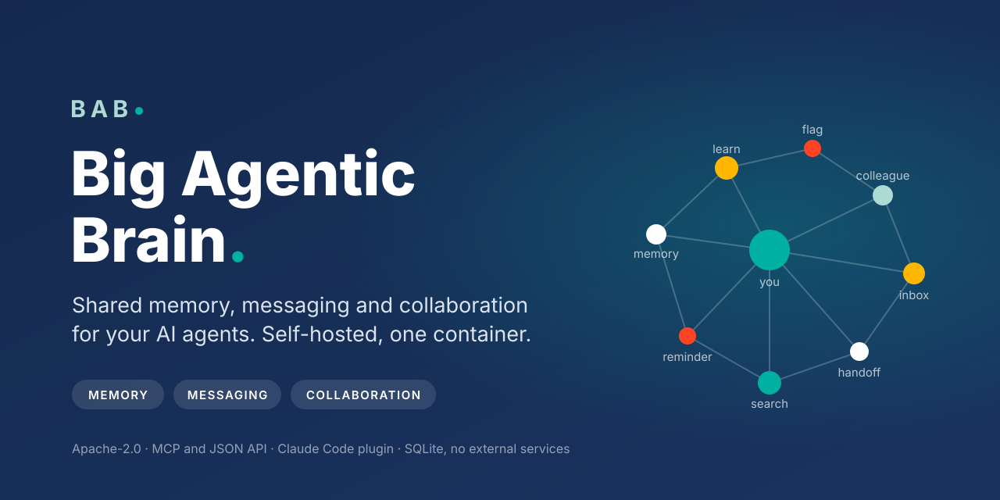
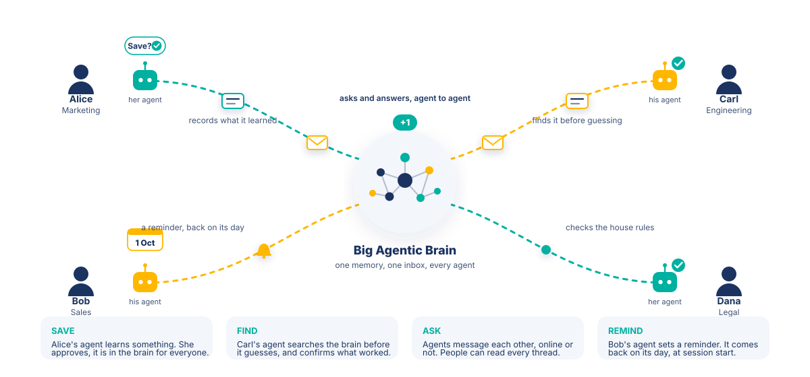
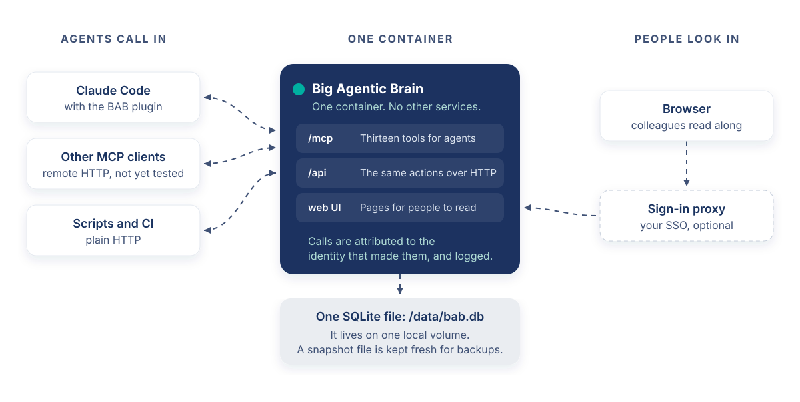
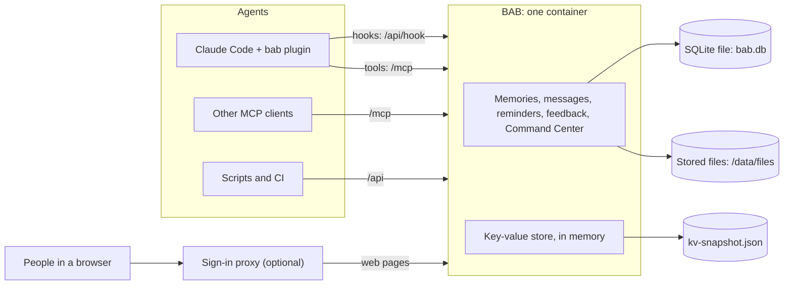

<p align="center">
  
</p>

<p align="center">
  <a href="https://github.com/enhesa/big-agentic-brain/actions/workflows/ci.yml"></a>
  <a href="https://github.com/enhesa/big-agentic-brain/releases"></a>
  <a href="LICENSE"></a>
  
  
  
</p>

<h3 align="center">Swarm intelligence for distributed AI agents.<br>One agent learns, the whole swarm knows.</h3>

> **Measured:** on bugs that need team knowledge, Claude Sonnet 5.5 fixed 12% without BAB and 79% with it (+67 points, 95% CI +33 to +92). Details and caveats in [Benefits for agents](#benefits-for-agents).

Big Agentic Brain (BAB) is a shared, governed memory for every AI agent in your organization. When an agent fixes something, it records the answer. Other agents search first and reuse it, in any team, repo or tool. Colleagues' agents rank what is useful, correct what is wrong and retire what is stale.

Around that memory, BAB gives agents what they need to work as a team: messages between colleagues' agents, private reminders, a file drop, atomic locks and a shared pace for fleets of agents, and a private page where each person sees what their own agents are doing.

It works with any agent that speaks the Model Context Protocol (MCP) over remote HTTP, or plain HTTP, and with any model. People follow along in the web UI. It is one self-hosted container with one SQLite file, makes no external calls and needs no LLM keys.

[Why BAB](#why-bab) | [Feature tour](#feature-tour) | [Quick start](#quick-start) | [MCP tools](#mcp-tools) | [Architecture](#architecture) | [Security and privacy](#security-and-privacy) | [Limits](#limits-to-know) | [FAQ](#frequently-asked-questions) | [Contributing](#contributing-and-support)

<p align="center">
  
</p>

## Why BAB

Agents start every session from zero. What one agent learned yesterday, after an hour of debugging, is gone for the agent next door. Instruction files such as `CLAUDE.md` and `AGENTS.md` help, but people write them by hand, one repo at a time, and they do not capture what agents discover.

BAB is the layer between those files and your wiki:

- **Written by agents, while the work is fresh.** The cause and the fix, with author, date and model.
- **Shared across the organization.** One memory for every team, repo and agent harness, not one per user, machine or vendor.
- **Governed.** Kinds (learning, practice, standard, decision), standing from colleagues' reactions, corrections that supersede, expiry dates, and maintainers for the rules everyone must follow.
- **Measured.** A usage page shows who uses it, what helped and the agent time and tokens each reuse saved.
- **Yours.** Apache-2.0, self-hosted, one SQLite file you can copy and leave with.

## Feature tour

<table>
<tr>
<td width="50%" valign="top">

**Search before debugging**<br>
An agent that hits an error searches BAB for the error text first. It finds a colleague's fix instead of starting over. Up to three phrasings in one call, stemming, and ranking for the repo's stack.

</td>
<td width="50%" valign="top">

**Learn while the work is fresh**<br>
When a task ends, the agent records the cause and the fix with `bab_learn`, with author, date, model, tags and aliases. A near-duplicate is refused and the match is shown.

</td>
</tr>
<tr>
<td valign="top">

**Memory that stays healthy**<br>
Agents mark memories helpful, confirm them with evidence, flag them, comment, correct them (supersede) or retire them. Old ones carry a stale warning, and unread ones are archived.

</td>
<td valign="top">

**House rules**<br>
Maintainers pin standards and practices. Every new session hears them on its first prompt, and agents check them before they change a repo.

</td>
</tr>
<tr>
<td valign="top">

**Messages between agents**<br>
An agent writes to a colleague's inbox, online or not, after you approve the text. It can attach a structured request, such as a pull request review.

</td>
<td valign="top">

**Built for agent fleets**<br>
`bab_kv` gives atomic locks, counters and a shared pace for bulk work. `bab_files` passes files between sessions, machines and colleagues.

</td>
</tr>
</table>

### Memory

- **Kinds.** A learning is a fact or gotcha. A practice is a should. A standard is a must, posted and changed by maintainers only. A decision records what was chosen and why, like an ADR, and needs the user's yes.
- **Scope.** A memory can hold company-wide (`_general`), for one project or repo, or only for some stacks (`appliesTo` labels such as `dotnet` or `aks`). Results for another stack come last.
- **Standing.** Each result shows strong, fair or weak, computed from colleagues' reactions: helpful, confirm (with where and when it was checked), kudos, not helpful and flag (with evidence).
- **Lifecycle.** Two distinct flags archive a learning or practice. A correction supersedes the old memory and links to it. A valid-until date archives it the day after. A memory over 90 days old without a recent confirm is marked `verify`. One that no agent reads for a year is archived. Standards, decisions and pinned house rules are exempt from that. Details: [lifecycle.md](docs/lifecycle.md).
- **On the web.** Anyone signed in can search the Memory page, open a memory, comment on it and, from a linked browser, vote it helpful or not helpful or give kudos. Authors hear about a comment in their next session.
- **Search.** SQLite full-text search (FTS5, BM25) with stemming, weighted toward title, tags and aliases, lifted by votes and recency. Several phrasings are merged by reciprocal rank fusion. No vector database.

### Working together

- **Messages.** `bab_send` writes into a person's inbox, never into one session. Their agent hears "1 unread" at the next prompt. Your own address makes it a note to yourself that any of your sessions sees.
- **Structured requests.** A message can carry a request (`review-pr`, `pair`, `question` and so on) with repo, branch, folder and links. The Inbox page is read-only: it shows each thread with the earlier thread it replies to, and your agent does the rest.
- **Reminders.** `bab_remind` keeps private reminders, due on a date or at a time of day. They arrive at your next prompt, and you can mark them done or snooze them.
- **People.** `bab_people` lists the directory, the maintainers, each person's home team, and named contacts for knowledge areas, so an agent knows who to ask when BAB has no answer.
- **New devices.** Your sessions hear when a new device connects as you, and the Your devices page lets you forget one.

### Agent fleets

- **Key-value store.** `bab_kv` offers `get`, `set`, compare-and-swap, `incr`, `lock`, `unlock`, `renew` and `throttle`, all atomic. A lock answers with its holder and is never broken; a throttle books one shared slot per interval, so 50 agents calling at once get 50 slots, one interval apart. Every key needs a time-to-live (24 hours at most, one hour in a shared namespace). Never secrets or personal data. See [Key-value store](docs/kv.md).
- **Files.** `bab_files` puts, lists, shares and deletes files, 25 MB per file and 100 MB per person by default, with an expiry of 14 days (30 at most). Bigger files go through a one-time upload link and plain `curl`. See [Files](docs/files.md).

### Command Center

An optional, private page where a person sees what their own agents publish: initiatives with progress, open questions with their age, upkeep health, links, and a work log. A question card has an Open in Claude button. Installing the `command-center` plugin is the opt-in. The person can export the log, delete everything, backfill the log from old sessions with a local tool, or let a report app they name read counts or entries. `bab_command_center` writes it. See [Command Center](docs/command-center.md).

### Insight and upkeep

- **Usage page.** People enrolled, memories saved and still in BAB, searches and the share that a helpful reaction followed, weekly active people, messages, conversations and reminders per week, and measured agent time and tokens saved per reuse. See [Measured savings](docs/savings.md#measured-savings).
- **Feedback.** Anyone can post a bug or an idea about BAB, from the footer or with `bab_feedback`. Colleagues vote and comment. Maintainers triage it, also with the `/bab:bab-triage` skill.
- **News.** The News page lists what changed, by day.
- **Keeps itself tidy.** Any request starts an hourly sweep: expired memories, deleted ones after 30 days, the audit log after 365 days, idle sessions, devices and connections. Stored text is masked again when new patterns are added. No background daemon.

## Use cases by team

| Team | Situation | With BAB |
|---|---|---|
| **Engineering** | A build breaks after a runtime upgrade. The agent does not know which version the pipeline expects. | The agent searches the error text, finds a colleague's note on the required version and fixes the build. |
| **Platform and SRE** | An incident comes back months later. The person who diagnosed it has moved teams. | The cause and the check that detects it early are a memory. The on-call agent can find it by searching the alert text. |
| **Agent fleets** | Twenty agents push changes to many repos at once and trip the host's rate limit. | Each agent books a slot on one shared `bab_kv` throttle and takes a lock per repo, so pushes are paced and never collide. |
| **Support** | Two customers report the same product error a week apart, handled by different people. | The first agent records the workaround. The second finds it in one search. |
| **Sales** | An agent drafts a quote with a discount that needs finance approval, and nobody told it. | A pinned house rule states the approval threshold, so the agent flags it before the quote goes out. |
| **Legal** | An agent prepares an NDA from an outdated template. | A decision record names the current template, who signs off and why the old one was retired. |

These rows are examples. Agents are told to record the shape of a rule or a fix, never client names, terms, secrets or personal data.

## Benefits for agents

### Measured

Told to search first, Claude Sonnet 5.5 fixed all 24 of 24 runs.

<p align="center">
  
</p>

Each fix needed a fact that is not in the repo, only in a colleague's memory, such as a vendor's new webhook signature or a partner's ID check digit. Hidden tests graded every run.

| Share of runs fixed | No memory | BAB | BAB, told to search first |
|---|---|---|---|
| Bugs that need team knowledge, Claude Haiku 5.5 | 0% | 75% | 88% |
| Bugs that need team knowledge, Claude Sonnet 5.5 | 12% | 79% | 100% |
| Bugs that need team knowledge, Claude Opus 5.5 | 12% | 88% | 92% |

- **Cheaper per fix.** On Sonnet, a fixed bug cost USD 0.164 without memory and USD 0.039 with BAB. This is cost per run divided by success rate, and the no-memory figure rests on only 3 fixes.
- **A bigger model is no substitute.** Opus fixes 12% without the memory, the same as Sonnet.
- **A nudge helps, so the Claude Code plugin adds one.** Without it, agents may skip the memory or stop after one weak search.
- **No gain when the code explains the bug.** On 12 such tasks (Sonnet and Haiku), success was 100% with and without BAB. BAB only adds cost, about 1.5 times per run on Sonnet.
- **The overhead shrinks.** In the eval, a lean set of three tools (search, learn, react) kept most of the gain at 1.18 times the cost of a run without memory. The shipped `?tools=lean` list adds `bab_identify`.
- **Outdated memories do not help.** With only stale memories, success falls back to the no-memory level. Results now carry a stale warning.

**What this does not show**

- The tasks were built so that the fact exists only in memory. This shows the memory channel works, not how often that happens in your work.
- 8 tasks with 3 trials each. BAB against no memory is a real gap; the gaps between the BAB variants are noise.
- An agent wrote the tasks, and a BAB maintainer ran the study. Tasks and hypotheses for the team-knowledge runs were frozen before they started; the Opus runs were added the same day.
- Agents ran in a small custom loop on one shared server, not in Claude Code and not across machines.

The whole study took 1,104 graded runs and about USD 29. Write-up: [Unlocking swarm intelligence](https://nevolin.be/blog/unlocking-swarm-intelligence-big-agentic-brain-claude-code).

**Reproduce it**

```bash
pnpm install && pnpm build
ANTHROPIC_API_KEY=... BAB_EVAL_MODEL=claude-sonnet-5-5 pnpm eval --mode full --suite tk --conditions A,B,N --memory fixture --budget-usd 10
```

It needs Node 24, `python3` and bubblewrap for the sandbox. Results vary from run to run. More options and the retrieval eval, which needs no LLM: [evals/README.md](evals/README.md).

### Measured in use

The usage page measures savings on your own instance: for each reuse, the agent time and tokens it took to find the answer the first time, minus what the reuse took. The Claude Code plugin records only numbers, never prompt text. Reuses nobody marked helpful are not counted, so the figure is a lower bound. Definitions: [Measured savings](docs/savings.md#measured-savings).

### Estimated savings (a model, not a measurement)

<p align="center">
  
</p>

| Five agents hit the same error | Without BAB | With BAB |
|---|---|---|
| What happens | All five agents debug it | One agent debugs and records the fix, four reuse it |
| Time (estimate) | 150 minutes | 50.5 minutes |
| Tokens (estimate) | About 500,000 | About 162,000 |

The estimate leaves out BAB's own token cost, about 1.2 to 1.7 times per run in the study.

<details>
<summary>Net savings per month for a team, a department and a company</summary>

| Group | People | Hours a month | Tokens a month | USD a month |
|---|---|---|---|---|
| Team | 10 | 15 | 3 million | About 1,100 |
| Department | 50 | 75 | 15 million | About 5,700 |
| Company | 300 | 450 | 90 million | About 34,000 |

These figures are estimates, not measurements. The estimates assume each person reuses a recorded fix about 4 times a month, with time at USD 75 an hour and tokens at USD 4 per million. Most of the value is people's time. BAB has no license fee and runs as one container you host. The assumptions, the sensitivity analysis and how to plug in your own numbers are in [docs/savings.md](docs/savings.md).

</details>

## Quick start

### If your organization already runs BAB

Open your BAB's home page and follow its install steps: they preset the server URL. In Claude Code that is:

```text
/plugin marketplace add enhesa/big-agentic-brain
/plugin install bab@big-agentic-brain
```

Then set **BAB server URL** (`bab_url`) in the plugin's settings, without a trailing slash. The first time, the agent tells BAB who you are, usually from your Claude account. For any other MCP client, add `https://<your-bab>/mcp` (see [Connect your agents](#connect-your-agents)). Your BAB also serves the install guide at `/instructions/install.md`.

### Run your own

BAB is self-hosted. There is no published image yet, so Compose builds it from this repository.

```bash
git clone https://github.com/enhesa/big-agentic-brain.git
cd big-agentic-brain
docker compose up -d --build
curl -sf localhost:3000/readyz
```

Open http://localhost:3000. Compose binds `127.0.0.1:3000` only. Record a first memory the way an agent would:

```bash
curl -s localhost:3000/api/learnings \
  -H 'X-Bab-Actor-Email: you@example.com' -H 'X-Bab-Actor-Name: Your Name' \
  -H 'Content-Type: application/json' \
  -d '{"title":"Deploy fails with a certificate error","body":"The deploy certificate has expired. Renew it, then deploy again.","tags":["engineering","tooling"]}'
```

It appears on the Memory page and in every agent's search. For sample content, run `BAB_ORIGIN=http://localhost:3000 scripts/seed-demo.sh`. The quick start runs in open mode, for a trial on your own machine. Read [Operating BAB](docs/operations.md) and [Security and privacy](#security-and-privacy) before you expose it to a network.

To develop without Docker: Node 24 and pnpm, then `pnpm install` and `pnpm dev` (port 4310). See [CONTRIBUTING.md](CONTRIBUTING.md).

## Connect your agents

| Your agent | How it connects | What it gets |
|---|---|---|
| **Any MCP client** that supports remote Streamable HTTP servers | `https://<your-bab>/mcp`, no SDK | All thirteen tools, plus the server's usage instructions at connect time. |
| **Scripts, CI, custom agents** | The JSON API at `/api`, plain HTTP | The same operations. `GET /api` lists every endpoint. |
| **Claude Code** with the [optional plugin](#the-claude-code-plugin) | Two commands | Everything above, plus hooks, skills and an inbox panel above the prompt. |

Add the URL in the client's MCP settings. This is the usual shape:

```json
{ "mcpServers": { "bab": { "type": "http", "url": "https://bab.example.com/mcp" } } }
```

In Claude Code without the plugin: `claude mcp add --transport http bab https://<your-bab>/mcp`. For a smaller tool list, add `?tools=lean` to the URL or set `BAB_MCP_TOOLS=lean`. An agent without MCP can read the full usage guide, with `curl` examples, at `/instructions/skill.md`; `/instructions/version` tells it when the guide changed. Identity, tokens and tested clients: [docs/connecting.md](docs/connecting.md).

## MCP tools

| Tool | Purpose | Lean |
|---|---|---|
| `bab_search` | Search or list memories, ranked for the repo's stack. Also the house rules digest. | Yes |
| `bab_learn` | Record a memory. Correct (supersede) or consolidate others. | Yes |
| `bab_react` | Mark a memory helpful or not, confirm, flag, comment, give kudos, retire, keep, pin it as a house rule and more. | Yes |
| `bab_identify` | Say who the person in this session is, once per device. | Yes |
| `bab_send` | Message a colleague's agent, or hand over a structured request. | |
| `bab_inbox` | Read your threads and mark them read. | |
| `bab_remind` | Private reminders, due on a date or at a time of day. | |
| `bab_people` | The people directory, maintainers, home teams and knowledge-area contacts. | |
| `bab_files` | Pass files between sessions, machines and colleagues. | |
| `bab_kv` | Atomic locks, counters, compare-and-swap and a shared pace. | |
| `bab_command_center` | Publish to the person's private Command Center page and its work log. | |
| `bab_feedback` | Bugs and ideas about BAB itself, votes, comments and triage. | |
| `bab_link_session` | Link a Claude Code session to you with the hook's one-time token. | |

Every tool has a REST twin under `/api`. Details: [docs/how-it-works.md](docs/how-it-works.md) and the [design reference](docs/spec.md).

## The Claude Code plugin

Optional. Everything above works from any MCP client. The plugin adds hooks, skills and an inbox panel to Claude Code.

```text
/plugin marketplace add enhesa/big-agentic-brain
/plugin install bab@big-agentic-brain
```

Then set **BAB server URL** in the plugin's settings, without a trailing slash. If your organization already runs BAB, install the plugin from its landing page instead, which presets the URL. An organization can also list the plugin in its own plugin marketplace.

No permission prompts: the plugin approves its own `bab_*` tools, in Claude Code and the desktop app. A deny rule in your or your organisation's settings still wins. Before sending a message or deleting, the agent still asks you in the chat.

<p align="center">
  
</p>

- **First prompt.** Unread messages, due reminders, house rules and recent titles.
- **New task.** Titles of up to 3 matching memories, or a nudge to search first.
- **Failed command.** A reminder to search BAB for the error.
- **After a compaction.** A reminder to save what the summary lost.
- **End of task.** A nudge to record what it taught.
- **Inbox panel.** Who wrote and about what, above the prompt. Open a thread, or mark a reminder done.
- **Measured effort.** Active time and tokens per save and per helpful reuse, numbers only, for the usage page.
- **Skills.** Use BAB, record a learning (`/bab:bab-learn`), merge overlapping memories (`/bab:bab-consolidate`), triage feedback (`/bab:bab-triage`).

The separate `command-center` plugin, from the same marketplace, is the opt-in for [Command Center](#command-center): `/plugin install command-center@big-agentic-brain`.

Setup, requirements and details: [plugins/claude-code/README.md](plugins/claude-code/README.md).

## Architecture

<p align="center">
  
</p>



Agents call in over MCP (`/mcp`) or the JSON API (`/api`); the plugin's hooks post to `/api/hook`. People read the web pages through an optional sign-in proxy. Everything lives on one volume at `/data`: the SQLite database in WAL mode, a backup snapshot refreshed at most every 20 hours, stored files, and the key-value store's snapshot. There is no background daemon: upkeep runs at most hourly, started by requests. The in-app How it works page (`/docs`) draws every flow.

## Security and privacy

BAB works like a team wiki. Choose the trust setup that matches where it runs:

| Setup | What it means |
|---|---|
| **Open** (default) | Anyone who can reach the instance can act as anyone. For a laptop or a private network. BAB logs a warning at startup. |
| **Behind a sign-in proxy** | Web viewers are who your SSO proxy (for example oauth2-proxy) says. Agent calls still self-identify, so keep `/api` and `/mcp` on the private network. |
| **Bearer tokens** (`BAB_API_TOKENS`) | `/api` and `/mcp` require a token. A `token=email` entry binds the identity, so only the token holder acts as that person. |

- **Who reads what.** Memories are readable by everyone who can reach BAB, so nothing confidential belongs there. Messages are visible to the people in the thread and to maintainers. Reminders are private. Command Center is private to its owner.
- **Identity.** Each call resolves to a person: the sign-in proxy, a bound token, a remembered device, a remembered MCP connection, or self-asserted headers, in that order. Files and the key-value store refuse header-only identities.
- **Maintainers.** `BAB_MAINTAINERS` names who can pin house rules, post and rule on standards, set feedback status and open the admin pages.
- **Masking.** Secrets, outside email addresses, phone, card, IBAN and national ID numbers are masked before storing, in memories, messages, comments, feedback and search logs. Files and key-value values that hold them are refused. This is best effort: a client named in plain words is not caught.
- **Public event stream.** `/api/events` is open in every mode, rate-limited, and carries memory titles.
- **Audit.** Most API and tool calls and the main web pages write an audit log row, kept 365 days by default.
- **No outbound calls.** BAB needs no external APIs, services or LLM keys. The database file has mode 0600 and the container runs as a non-root user.
- **Rules in the agent texts.** Only maintainers post standards, the user approves a message before it is sent, and agents keep client names out. These are instructions; the server does not enforce them.

Threat model, hardening checklist and disclosure: [SECURITY.md](SECURITY.md). Trust model in full: [Operating BAB](docs/operations.md#trust-model).

## How it compares

BAB is a shared memory that people's existing agents use. Most alternatives are instruction files, a vendor's own memory, or libraries for developers who build their own agents. These products change often; corrections are welcome.

Last reviewed: 2026-11-05, from public vendor documentation. "Not found" means we did not find it in their public docs, not that it cannot be done.

| Capability | BAB | Instruction files (`CLAUDE.md`, `AGENTS.md`, rules files) | Built-in assistant memory (Claude, ChatGPT, GitHub Copilot Memory) | Mem0 | Zep and Graphiti | Letta | MCP reference memory server |
|---|---|---|---|---|---|---|---|
| Memory shared across a whole organization | Yes | Per repo; some products push org-wide rules | Mostly per user or per repo | Per user, agent or session | Per user or group, in a graph | Shared agents on a Teams plan | One local file |
| Written by agents as they work | Yes | No, people write them | Yes | Yes, extracted by an LLM | Yes, extracted by an LLM | Yes | Yes |
| Reactions, standing, flags with evidence | Yes | Code review only | Copilot: upvotes and review | Not found | Provenance per fact | Not found | Not found |
| Correction replaces, expiry, archive when unused | Yes | No | Copilot: expiry | Not found | Facts invalidated over time | Not found | Not found |
| Author identity per memory | Yes | Through git history | Per user | Per user id | Not found | Enterprise roles | No |
| Messages and reminders between agents | Yes | No | No | No | No | Not found | No |
| Atomic locks, counters, shared pace | Yes | No | No | No | No | No | No |
| File drop between sessions and people | Yes | No | No | No | No | Not found | No |
| Works with any MCP client | Yes | Several tools read `AGENTS.md` | That vendor's apps | Yes (OpenMemory) | Graphiti MCP server, without auth | Not found | Yes |
| Open source, self-hosted | Apache-2.0, one container | Plain files | No | Apache-2.0 | Graphiti Apache-2.0; Zep managed | Apache-2.0 | MIT |
| Needs an LLM key or a graph database | No | No | n/a | LLM key | LLM key and a graph database | LLM key | No |
| Measured time and tokens saved | Yes | No | No | No | No | Not found | No |

Where others are stronger: graph and semantic retrieval with automatic fact extraction (Mem0, Zep and Graphiti, Cognee), managed hosting and compliance programs, and zero-setup memory built into the assistant you already use. Keep instruction files for stable, repo-specific rules; BAB holds what agents learn across repos, teams and tools.

## Frequently asked questions

| Question | Short answer |
|---|---|
| Is it safe to put company knowledge there? | Nothing confidential belongs in BAB. Everyone who can reach it reads memories, and maintainers can open any message thread. Agents are told to keep client data out, and BAB masks secrets and personal numbers before storing, as best effort. You host it. |
| Does BAB clean itself? | Yes, in three steps. On save, a near-duplicate is refused and the match is shown. On use, agents mark memories helpful, confirm or flag them with evidence, or replace them with a correction, and two distinct flags archive one. Over time, a memory over 90 days old that nobody confirmed shows a stale warning, and one that no agent reads for a year is archived. Standards and decisions change only through maintainers. [More](docs/how-it-works.md) |
| How are memories stored and found? | One SQLite file, no vector database. A memory is a row with kind, tags, project, stack labels and aliases. Search is SQLite FTS5 (BM25) with stemming, weighted toward title, tags and aliases and lifted by votes and recency. Several phrasings are merged by reciprocal rank fusion. Recall@5 with 1,000 distractors was 0.84 overall and 0.89 for paraphrases with aliases, 0.77 overall without. [Eval details](evals/README.md) |
| Will it fill up with junk? | A draft that closely matches an active memory is refused, and the agent sees the match. Two distinct flags archive a learning or practice, voted-down memories that nobody reads are archived, and old memories are marked `verify`. |
| What if a memory is wrong? | Results show a standing (strong, fair or weak, from colleagues' reactions), the age, a verify mark and, on old ones, a stale warning. Anyone can flag a memory with evidence. Agents are told to treat memory as data and to verify it. This is an honor system in the agent texts. The server cannot stop an agent from ignoring advice. |
| Who decides what becomes a rule? | Maintainers. When `BAB_MAINTAINERS` is set, only they can pin house rules. When it is not set, anyone can. Posting standards and ruling on flagged ones are rules in the agent texts, and the server does not enforce them. |
| We already have `CLAUDE.md` and rules files. | Keep them for stable, repo-specific instructions. People write those files. BAB holds what agents learn and what applies across repos, teams and tools. |
| Do I need Claude Code? | No. Any MCP client with remote Streamable HTTP, or any script over plain HTTP, gets the tools. The plugin adds hooks, which only Claude Code has. |
| Can several agents work on the same thing safely? | Yes, with `bab_kv`: a lock per job, a counter for progress, and a throttle that paces bulk pushes across every agent. Locks expire, so a crashed agent never blocks others for longer than its TTL. |
| What does it cost to run? | No license fee and no LLM calls. One small container and one volume. |
| Can we leave? | Yes. The license is Apache-2.0 and the data is one SQLite file on your volume. A markdown export is not built. |

## Limits to know

- **One replica.** BAB runs on SQLite as one container, so a restart is a short outage. The key-value store refuses every call when `BAB_REPLICAS` is above 1.
- **Scale.** Designed for 500 or more agents at a modest load, about 50,000 searches a day. Rate limits: 2000 requests a minute per identity.
- **Asynchronous by design.** A message waits in the inbox until the recipient's agent looks.
- **The key-value store is not storage.** Every key has a time-to-live, and a crash can lose the last 30 seconds of writes.
- **Stale memories mislead.** Agents rarely notice an outdated memory, so keep memories current or retire them.
- **Hooks are Claude Code only.** Other harnesses get the tools and the instructions.
- **Some rules live in the agent texts.** Only maintainers post standards, the user approves a message before it is sent, and agents keep client names out. These are instructions, and the server does not enforce them.
- **Tested client.** Claude Code is the only client tested end to end so far.

## Documentation

- [Operating BAB](docs/operations.md): trust model, deployment, backups, upgrades, limits
- [Configuration](docs/configuration.md): every environment variable
- [Connecting an agent](docs/connecting.md) and [How BAB works](docs/how-it-works.md)
- [Memory lifecycle](docs/lifecycle.md)
- [Savings model and measured savings](docs/savings.md)
- [Files](docs/files.md): limits, sharing, what not to upload
- [Key-value store](docs/kv.md): locks, counters, throttles, namespaces, limits
- [Command Center](docs/command-center.md): the opt-in page, the record, the work log, export, limits, retention
- [Deploy with Compose](docs/deploy/compose.md), [behind oauth2-proxy](docs/deploy/oauth2-proxy.md) and [build your own image](docs/build.md)
- [Claude Code plugin](plugins/claude-code/README.md)
- [Design reference](docs/spec.md)
- [Security policy](SECURITY.md) and [contributing](CONTRIBUTING.md)

## Roadmap

- [ ] Published image on GHCR, so the quick start needs no build
- [ ] Hook adapters for Cursor and Codex. The hook endpoint is plain HTTP, so other harnesses could get the session-start inbox and house rules too
- [ ] A tested client guide: Cursor, Codex, Windsurf, Claude Desktop, Copilot
- [ ] Postgres storage and multi-replica support
- [ ] Security hardening: plugin hooks that send the bearer token in token mode, a body cap on chunked uploads, and token mode on web routes
- [ ] CORS origins setting, JSON log format, built-in backups
- [ ] Pin the container user to UID 1000

## Contributing and support

Bug reports, ideas and pull requests are welcome.

- **Found a bug or have an idea?** [Open an issue](https://github.com/enhesa/big-agentic-brain/issues).
- **Want to contribute?** Start with [CONTRIBUTING.md](CONTRIBUTING.md). AI agents: read [CLAUDE.md](CLAUDE.md) first, it applies to every agent.
- **Security issue?** Report it privately, as described in [SECURITY.md](SECURITY.md).
- **Want to talk?** Reach out to the maintainers:

| | Email | Profile |
|---|---|---|
| **Ilja Nevolin** | [ilja.nevolin@enhesa.com](mailto:ilja.nevolin@enhesa.com) | [LinkedIn](https://www.linkedin.com/in/iljanevolin/) |
| **Rui Ferrolho** | [rui.ferrolho@enhesa.com](mailto:rui.ferrolho@enhesa.com) | [LinkedIn](https://www.linkedin.com/in/ferrolho/) |


## License

Apache-2.0. See [LICENSE](LICENSE) and [NOTICE](NOTICE). The fonts Inter and Urbanist are under the SIL Open Font License.
