# Benefits for agents

The [README](../README.md#benefits-for-agents) has the headline numbers. This page has the study, its caveats and the savings model.

## Measured

Told to search first, Claude Sonnet 5.5 fixed all 24 of 24 runs.

<p align="center">
  
</p>

Each fix needed a fact that is not in the repo, only in a colleague's memory, such as a vendor's new webhook signature or a partner's ID check digit. Hidden tests graded every run.

| Share of runs fixed | No memory | BAB | BAB, told to search first |
|---|---|---|---|
| Bugs that need team knowledge, Claude Haiku 5.5 | 0% | 75% | 88% |
| Bugs that need team knowledge, Claude Sonnet 5.5 | 12% | 79% | 100% |
| Bugs that need team knowledge, Claude Opus 5.5 | 12% | 88% | 92% |

On Sonnet that is +67 points for BAB against no memory, with a 95% confidence interval of +33 to +92.

- **Cheaper per fix.** On Sonnet, a fixed bug cost USD 0.164 without memory and USD 0.039 with BAB. This is cost per run divided by success rate, and the no-memory figure rests on only 3 fixes.
- **A bigger model is no substitute.** Opus fixes 12% without the memory, the same as Sonnet.
- **A nudge helps, so the Claude Code plugin adds one.** Without it, agents may skip the memory or stop after one weak search.
- **No gain when the code explains the bug.** On 12 such tasks (Sonnet and Haiku), success was 100% with and without BAB. BAB only adds cost, about 1.5 times per run on Sonnet.
- **The overhead shrinks.** In the eval, a lean set of three tools (search, learn, react) kept most of the gain at 1.18 times the cost of a run without memory. The shipped `?tools=lean` list adds `bab_identify`.
- **Outdated memories do not help.** With only stale memories, success falls back to the no-memory level. Results now carry a stale warning.

### What this does not show

- The tasks were built so that the fact exists only in memory. This shows the memory channel works, not how often that happens in your work.
- 8 tasks with 3 trials each. BAB against no memory is a real gap; the gaps between the BAB variants are noise.
- An agent wrote the tasks, and a BAB maintainer ran the study. Tasks and hypotheses for the team-knowledge runs were frozen before they started; the Opus runs were added the same day.
- Agents ran in a small custom loop on one shared server, not in Claude Code and not across machines.

The whole study took 1,104 graded runs and about USD 29. Write-up: [Unlocking swarm intelligence](https://nevolin.be/blog/unlocking-swarm-intelligence-big-agentic-brain-claude-code).

### Reproduce it

```bash
pnpm install && pnpm build
ANTHROPIC_API_KEY=... BAB_EVAL_MODEL=claude-sonnet-5-5 pnpm eval --mode full --suite tk --conditions A,B,N --memory fixture --budget-usd 10
```

It needs Node 24, `python3` and bubblewrap for the sandbox. Results vary from run to run. More options and the retrieval eval, which needs no LLM: [evals/README.md](../evals/README.md).

## Measured in use

The usage page measures savings on your own instance: for each reuse, the agent time and tokens it took to find the answer the first time, minus what the reuse took. The Claude Code plugin records only numbers, never prompt text. Reuses nobody marked helpful are not counted, so the figure is a lower bound. Definitions: [Measured savings](savings.md#measured-savings).

## Estimated savings (a model, not a measurement)

<p align="center">
  
</p>

| Five agents hit the same error | Without BAB | With BAB |
|---|---|---|
| What happens | All five agents debug it | One agent debugs and records the fix, four reuse it |
| Time (estimate) | 150 minutes | 50.5 minutes |
| Tokens (estimate) | About 500,000 | About 162,000 |

The estimate leaves out BAB's own token cost, about 1.2 to 1.7 times per run in the study.

### Net savings per month for a team, a department and a company

| Group | People | Hours a month | Tokens a month | USD a month |
|---|---|---|---|---|
| Team | 10 | 15 | 3 million | About 1,100 |
| Department | 50 | 75 | 15 million | About 5,700 |
| Company | 300 | 450 | 90 million | About 34,000 |

These figures are estimates, not measurements. The estimates assume each person reuses a recorded fix about 4 times a month, with time at USD 75 an hour and tokens at USD 4 per million. Most of the value is people's time. BAB has no license fee and runs as one container you host. The assumptions, the sensitivity analysis and how to plug in your own numbers are in [savings.md](savings.md).
